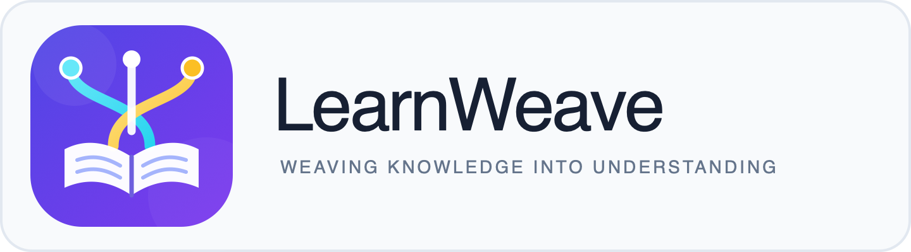

<p align="center">
  
</p>

# LearnWeave · From Material to Understanding

[中文](README.zh.md) | **English**

**LearnWeave turns knowledge materials into systems people can understand and learn.** It transforms slide decks, papers, and technical articles into guided explanations, learning paths, and traceable knowledge structures.

This repository contains two skills that can be installed separately:

- [slide-study](skills/slide-study/SKILL.md): explains a deck in its original page order and builds an offline study website.
- [architecture-first-reader](skills/architecture-first-reader/SKILL.md) turns a paper, technical article, or slide deck into a single offline HTML file that explains why the author chose a particular design.

**Original version:** [Download slide-study v1.0.0 ZIP](https://github.com/tzm224/LearnWeave/archive/refs/tags/v1.0.0.zip), tagged `v1.0.0` at commit `be044cc`. Extract and use `skills/slide-study/`.

## Read a design with architecture-first-reader

Sometimes you finish a paper knowing the name of the method but still wonder why the author needed a particular step. Give the material to this skill and open the resulting `index.html`. Start with the problem, then follow the design choices, the evidence behind them, and the costs they introduce.

The cache example opens with a puzzle. A writer has saved the new value and cleared the cache. How can the next request still read the old value? Follow one reader and one writer and you can see an earlier read refill the cache after it was cleared. That sequence explains why the version check and the cache update need to happen under the same lock.

- **Choose how far to go.** Read straight through or expand a counterexample, proof, or implementation detail where it comes up.
- **Inspect the evidence.** Click a reference to see the source location, what it supports, and whether the explanation is an author claim, direct evidence, or an AI inference. Close it to return to your place.
- **Follow a concept.** Search the graph, switch from the overview to mechanisms or details, and select an edge to see why two ideas connect. Jump back to the passage when you want the full explanation.

Try either synthetic example before installing. On GitHub, open the file, select **Download raw file**, then open the downloaded HTML in your browser.

- [Cache protocol](skills/architecture-first-reader/examples/versioned-cache/reader/index.html) walks through the race between a version check and a cache update in step 5.
- [Mergeable summaries](skills/architecture-first-reader/examples/mergeable-summary/reader/index.html) follows a two-block merge through its proof and explains how floating-point rounding limits the result.

### Install and use the skill

Clone the repository and copy the skill directory. These commands keep any existing installation in place.

```bash
git clone https://github.com/tzm224/LearnWeave.git
cd LearnWeave

skill_install_dir="${CODEX_HOME:-$HOME/.codex}/skills"
mkdir -p "$skill_install_dir"
if [ -e "$skill_install_dir/architecture-first-reader" ]; then
  printf '%s\n' 'architecture-first-reader already exists; back up or move the old version before installing.'
else
  cp -R skills/architecture-first-reader "$skill_install_dir/architecture-first-reader"
fi
```

Attach the material and ask Codex a reading question like this one.

```text
Use $architecture-first-reader to walk me through this paper in English.
I want to understand why the authors chose this design. Follow one concrete example
through the key steps and let me open the evidence and assumptions as I read.
```

Each analysis produces `output/architecture-first-reader/<material>/index.html`. Save or share that file to read it offline. You can later recover the editable analysis from the HTML and follow up on the same nodes. Opening an original source requires access to its file or URL. Building a reader uses Python 3.10+ and the bundled resources. See the [build and recovery instructions](skills/architecture-first-reader/SKILL.md) to convert an older analysis or resume editing.

The functionality, installation, and usage of `slide-study` follow below.

Turn a slide deck into an offline study website you can explore page by page or concept by concept.

`slide-study` is a Codex skill. It first reads the entire deck, then explains each page in its original order: what it teaches, why it appears at that point, and how it connects to the surrounding material. It also builds a knowledge graph with source pages and explanations for every relationship. It is designed for readers who know the subject's foundations but are studying this course for the first time.

## What it does

- **Guided notes for every page**: Start with a course overview and reading path, then explain mechanisms, examples, derivations, and takeaways. Keep cover pages brief, expand key ideas, and identify what changes across progressive slides.
- **Evidence-backed knowledge graph**: Merge synonymous concepts and connect prerequisites, derivations, applications, comparisons, problems and solutions, and supporting evidence. Every relationship includes a reason and links back to source pages.
- **Visible provenance**: Distinguish source material (`source`), supplementary explanations (`supplement`), reconstructed reasoning (`inference`), and unresolved content (`uncertain`).
- **Slides alongside explanations**: Use a side-by-side desktop layout and a stacked narrow-screen layout, with image zoom, search, a table of contents, page jumps, and previous/next navigation.
- **Interactive exploration**: Zoom, pan, search, and highlight neighboring concepts in the graph; navigate both ways between notes, concepts, and source pages.
- **A complete deliverable**: Cover the entire deck in one delivery, preserve the original file, and produce a standalone website folder, a ZIP archive, and editable course data.

## Inputs and outputs

Supports **PPTX and lecture PDF files**, plus legacy **PPT files** converted locally with LibreOffice. Each run handles one deck. PPTX pages and speaker notes are matched using the actual presentation order.

The generated folder contains:

```text
my-course/
├── index.html       # Study entry point
├── lesson.json      # Editable notes, concepts, and relationships
├── source.json      # Original page information and provenance
├── pages/           # Original page images
└── assets/          # Local scripts, styles, and math fonts
my-course.zip
```

Extract the ZIP and open `index.html` to study. The finished website needs no account, server, model API, or CDN; course data is embedded directly in the page. Creating a course requires an AI agent to read the deck, write the notes, and review the content. The scripts handle extraction, rendering, validation, and packaging.

**This README is available in Chinese and English. The study website's interface is currently Chinese, and explanations default to Chinese.** You can request another language for the explanations; the website has no interface language switch.

## Installation

Clone the repository and copy the complete skill folder into your local skills directory. These commands will not overwrite an existing `slide-study` installation:

```bash
git clone https://github.com/tzm224/LearnWeave.git
cd LearnWeave

skill_install_dir="${CODEX_HOME:-$HOME/.codex}/skills"
mkdir -p "$skill_install_dir"
if [ -e "$skill_install_dir/slide-study" ]; then
  printf '%s\n' 'slide-study already exists; back up or move the old version before installing.'
else
  cp -R skills/slide-study "$skill_install_dir/slide-study"
fi
```

The default location is `~/.codex/skills/slide-study`. If `CODEX_HOME` is set, the destination is its `skills/slide-study` subdirectory. Prepare the dependencies using the [environment guide](skills/slide-study/references/setup.md), then invoke the skill in a Codex environment that supports skills.

## Usage

Provide your deck to Codex and name the skill, for example:

```text
Use $slide-study to process this lecture.pdf.
Read the entire deck first, then explain every page in its original order:
its content, its role, and its connections to the preceding and following pages.
Add the background, examples, and derivations needed to understand it.
Build a knowledge graph with source-page references, and deliver the complete
offline study website and ZIP in one go. Write the explanations in English.
```

You can also specify your background, chapters to emphasize, explanation language, or output location. Long decks are processed internally by chapter, then reconciled for consistent terminology, transitions, and cross-chapter relationships.

## Generation environment

| Purpose | Dependencies |
| --- | --- |
| Python scripts | Python 3.10+, `pypdf`, and `Pillow`; versions are listed in [requirements.txt](skills/slide-study/requirements.txt) |
| PDF page rendering | Poppler's `pdftoppm` |
| Formula validation and website packaging | Node.js; uses the bundled KaTeX files, with no `npm install` needed |
| PPTX rendering | An installed Codex Presentations renderer, or LibreOffice `soffice` + Poppler as a fallback |
| Legacy PPT conversion | LibreOffice `soffice` |
| Reading the finished website | A modern browser; none of the generation tools above are needed |

See the [environment guide](skills/slide-study/references/setup.md) for dependency installation, executable paths, and script commands.

## Quality and limitations

Scripts validate page coverage, image assets, reciprocal concept references, source information, and formulas. Teaching explanations, derivations, and relationship evidence still need review against the original pages. Scanned PDFs require visual reading. Static pages cannot preserve full animation or video behavior, and converters may substitute fonts or change layouts. Unreadable content should be identified by its specific page number.

Development checks used real 47-page and 134-page decks, plus a PPTX fixture with reordered slides, hidden slides, and speaker notes. The package also includes 17 automated tests. Browser interactions were checked through a local HTTP preview, but the browser tool prohibited `file://` at the time, so opening the website directly from disk and with the network disconnected was not tested. Future generation tasks should verify this in a permitted environment and report any checks they could not complete.

## Repository layout

```text
skills/slide-study/
├── SKILL.md          # Skill entry point and workflow
├── agents/           # Codex interface metadata
├── references/       # Teaching standards, content contract, and setup
├── scripts/          # Preprocessing, validation, building, and tests
├── assets/           # Website template and local KaTeX resources
└── requirements.txt
```

- [Skill instructions](skills/slide-study/SKILL.md)
- [Teaching standards](skills/slide-study/references/teaching.md)
- [Content contract](skills/slide-study/references/content-model.md)

Math rendering uses the bundled **KaTeX 0.19.1**. Its third-party license is included in [KaTeX LICENSE](skills/slide-study/assets/vendor/katex/LICENSE), with source details in [provenance.json](skills/slide-study/assets/vendor/katex/provenance.json). That license applies to KaTeX and is not a license for the entire repository.
