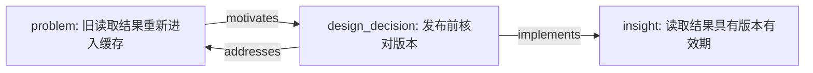

# Mermaid 图谱生成规范

`knowledge_nodes.json` 与 `knowledge_graph.json` 是事实源，`.mmd` 只是投影。不要从标题关键词推测关系，不把 Spine 的先后顺序自动转成 Graph 的因果边。

## 视图与方向

默认 `flowchart LR`，绘制 `views.L1` 中的节点与两端都在视图内的边。L2/L3 分别使用契约规定的累积视图。过滤不得生成“跨过隐藏节点”的替代边；不存在直接关系时，显示为不相连的节点是正确结果。

命令：

```text
python3 <skill-dir>/scripts/render_mermaid.py <output-dir> --output <output-dir>/knowledge_graph.mmd
python3 <skill-dir>/scripts/render_mermaid.py <output-dir> --level L2 --output <output-dir>/knowledge_graph-l2.mmd
python3 <skill-dir>/scripts/render_mermaid.py <output-dir> --level L3 --focus <node-id> --hops 1 --output <output-dir>/knowledge_graph-focus.mmd
```

邻居视图在所选层级内选取无向距离不超过 hops 的邻居，显示边仍保留原方向。焦点不在该层时应报错并提示提高层级，不能悄悄越过过滤条件。

关系的箭头完全遵循 [数据契约](data-contract.md)。`depends_on` 从依赖方指向前提；`part_of` 从部分指向整体；`supports` 从证据指向主张；`contrasts_with` 没有箭头。推断边用虚线，并在边标签保留推断提示；原文明确关系用实线。线条类型表示来源归属，不表示因果强度或置信区间。

节点标签保留短标题及类型，不能用标题替代稳定 ID。较长解释、证据和权衡留在 JSON 与 Markdown 中；默认宏观图不塞公式或整段论证。

## 转义与导航

渲染器使用与输入标题无关的稳定安全标识符，并对引号、方括号、尖括号、管道符、换行等字符编码或归一化。禁止把来源文字作为 Mermaid 指令、HTML、click 回调或初始化配置。无需依赖远程渲染服务；编辑器如支持 Mermaid 可直接查看，原始 `.mmd` 仍可独立读取。

导航由 Markdown 中的真实链接提供，不假定所有 Mermaid 阅读器都允许可点击节点。正文的 `[n:...]` / `[s:...]` 是机器可查标记，旁边应有对应文件/原文链接。默认图以外的 L2/L3 变体属于可选产物，不替换默认文件。

示意图仅说明方向，不作为自动填充的知识结构：



具体输出由脚本生成，显示名称和顺序以实际数据为准。自动校验可发现过期的默认 `.mmd`，但不能证明 Mermaid 阅读器的实际布局；报告是否做过渲染检查，不把文本生成说成视觉验证。

语法依据：[Mermaid 官方 Flowchart 语法](https://mermaid.js.org/syntax/flowchart.html)。Schema 的对象字段与必填项使用 [JSON Schema 官方对象规范](https://json-schema.org/understanding-json-schema/reference/object)。运行这些脚本不需要访问以上链接。
